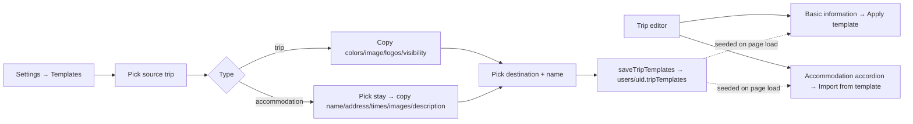

# Trip & Accommodation Templates

- **Date:** 2026-11-22
- **Status:** Implementing
- **Scope:** Account-level templates (`users/{uid}.tripTemplates`) + “apply template” flows in the trip editor
- **Backlog ticket:** F211

## Viability verdict

| Claim | Verdict | Detail |
|---|---|---|
| Templates can live in the user document | ✅ | `people` and `destinationFolders` already use the same pattern (`users/{uid}.<field>` + `data/services/*.service.ts` cache). |
| A trip skeleton can be rebuilt from an existing trip | ✅ | `colors`, `image` and `visibility` are top-level trip fields; destination links are `destinationRefs[].id`. |
| An accommodation template can be rebuilt from a saved stay | ✅ | The `accommodations` subcollection already exposes name/address/description/dates/images. |
| Applying values is a pure DOM operation | ✅ | The editor reads everything from inputs (`#light-color`, `#link-background`, `#accommodations-*`), so setting those + `refreshImagePickers()` is enough; the normal Save persists it. |
| Templates are per-user, not shared | ⚠️ | Shared viewers/editors cannot read the owner's user document, so templates only work for the signed-in owner. Accepted. |
| Backup/restore carries templates | ❌ | Account backup does not carry `destinationFolders` either — templates follow the same rule. |

## Key facts (grounded in the codebase)

- Settings tab: `public/index.html` `#tab-settings` → `.settings-section` (People section is the precedent), actions registered in `pages/home/support/event-listeners.ts` → `registerActions({...})`.
- Dialog helper: `utils/messages.ts` → `displayFullMessage(MESSAGE_PROPERTIES + fullscreen + getContainersInput())`, same as `pages/home/support/people.ts`.
- User doc read/write: `data/firebase/auth.ts` (`getUserData`, `setUserData`) + `data/firebase/database.ts` (`get`, `update`).
- Editor boot: `pages/edit-trip/edit-trip.ts` `loadEditTripPage()` already fetches the user doc (seeds `destinationFolders` and `people`).
- Customization values: `#colors-enabled`, `#light-color`, `#dark-color`, `#images-enabled`, `#link-background`, `#link-logo-light`, `#link-logo-dark`, `#theme-enabled`, `#theme-mode-*`.
- Accommodation rows: generated by `new-trip.ts` → `addAccommodations()`; photos live in the module-level `ACCOMMODATION_IMAGES[j]`.
- Destination picker: `#destinations-checkboxes .destination-card[data-destination-id]` + `.selected`; helpers `reorganizeDestinationsCheckbox()` and `updateActiveDestinationsHTMLs()`.
- Save: `set-trip.ts` reads the same inputs (`getColorsObject`, `getImageObject`, `getVisibilityObject`, `getModulesObject`) — no save-path change is needed.

## Resolved decisions (user answers, 2026-11-22)

1. **Creation happens in Settings only**, choosing an existing trip (trip skeleton) or an existing stay from a trip (accommodation) as the base. The Settings manager also lists, renames (via name field in creator) and deletes templates.
2. **Trip skeleton applies:** colors + background image + logos (light/dark) + theme/visibility + the linked destination. Enabled modules are **not** copied, except `destinations` (the template's destination is linked, so the module is enabled when needed).
3. **Filtering:** the picker shows only templates whose destination is already linked to the trip, plus a “show all destinations” toggle + search. Picking a template from another destination links that destination automatically (enabling the destinations module).
4. **Apply button lives in the “Basic information” tab** of the trip editor.
5. **Accommodation template copies:** name, address, check-in/out **times**, images and description. **Not** copied: check-in/out days, reservation code/link, payment status, breakfast (they change per booking).
6. **Multi-destination (follow-up, 2026-11-22):** picking the base trip auto-selects every destination linked to it, and the creator accepts more than one destination (searchable checkbox list). The picker matches a template when **any** of its destinations is linked to the trip and links all of them on apply.

## Data model

`users/{uid}.tripTemplates: TripTemplate[]`

```ts
type TripTemplate = TripSkeletonTemplate | AccommodationTemplate;

interface TripTemplateBase {
	id: string;               // 't' + base36 timestamp + random
	type: 'trip' | 'accommodation';
	name: string;             // user-facing template name
	destinationIds: string[]; // associated destinations (filter key; legacy docs: destinationId)
	sourceTripId: string;
	createdAt: string;        // ISO 8601
}

interface TripSkeletonTemplate extends TripTemplateBase {
	type: 'trip';
	colors: { active: boolean; light: string; dark: string };
	image: { active: boolean; background: string; light: string; dark: string };
	visibility: { light: boolean; dark: boolean };
}

interface AccommodationTemplate extends TripTemplateBase {
	type: 'accommodation';
	sourceAccommodationId: string;
	accommodation: {
		name: string;
		address: string;
		description: string;
		times: { checkIn: string; checkOut: string };   // 'HH:MM'
		images: { description: string; link: string }[];
	};
}
```

No summary-mirror work is required (templates are not indexed anywhere).

## End-to-end flow



## Phases

### P1 — Service (`data/services/trip-templates.service.ts`)
Normalize/seed/cache/load/save + id generation + type guards, mirroring `people.service.ts`.

### P2 — Settings manager
`pages/home/support/templates.ts`: preview section, fullscreen manager, in-memory draft list, creator sub-dialog (source trip → source accommodation → destination + name), save/delete.

### P3 — Editor apply flows
`pages/edit-trip/categories/trip-template.ts`:
- trip skeleton picker (basic-information button),
- accommodation picker (per-row button rendered by `addAccommodations()`),
- shared “linked destinations” filter + “show all” toggle + search,
- `ensureDestinationLinked()` and the accommodation field application.

### P4 — Wiring
`index.html` settings section, `edit/trip.html` basic-info button, `new-trip.ts` accommodation button, `customization.ts` `setColorsFromValues()`, action registration in both event-listener modules, seeding in `data.ts` / `edit-trip.ts`, CSS for the manager rows, en/pt translations.

## Files

**New**
- `public/assets/ts/data/services/trip-templates.service.ts`
- `public/assets/ts/pages/home/support/templates.ts`
- `public/assets/ts/pages/edit-trip/categories/trip-template.ts`

**Modified**
- `public/index.html`, `public/edit/trip.html`
- `public/assets/ts/pages/home/index.ts` (preview load), `support/data.ts`, `support/event-listeners.ts`
- `public/assets/ts/pages/edit-trip/edit-trip.ts`, `support/event-listeners.ts`, `categories/customization.ts`, `new-trip.ts`
- `public/assets/css/index/index.css`
- `public/assets/json/languages/en.json`, `pt.json`
- `.github/skills/data-model/SKILL.md`, `README.md`

## Risks & gotchas

- `buildColorPresets()` must not be called again on apply (it re-binds the arrow buttons). A dedicated `setColorsFromValues()` syncs pickers + swatch state instead.
- Destination cards may be inside collapsed folders — expand folders after linking.
- The accommodation date range pickers are not stored as instances (`addAccommodations()` drops them), so templates never touch the days — only the `HH:MM` inputs.
- “No new data” guard: applying a template that matches the current values will not produce a save; this is expected.
