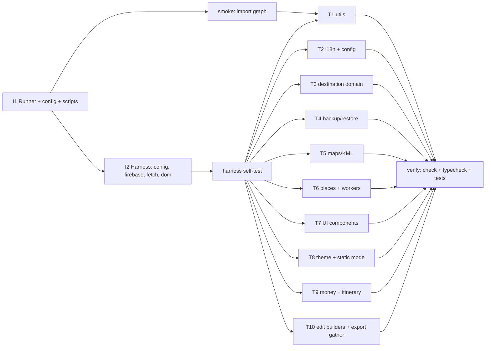

# Unit Tests (E047) — Implementation Prompts

- **Date:** 2026-11-22
- **Status:** Decided — ready to implement (decisions recorded in [§10](#10-resolved-decisions))
- **Scope:** Test infrastructure + unit-test coverage for the vanilla-TS frontend and the Cloudflare Workers. **Cloud Functions are out of scope** — they exist only to run the migrations, and those have already run.
- **Backlog ticket:** E047 — `[DEV] Implement Unit Tests` (epic stays in `## Backlog` until every prompt is green)
- **Format:** **12 prompts** — 2 for infrastructure (`I1`, `I2`) and 10 for tests aggregated by context (`T1`–`T10`). Prompts are self-contained; each can be run in a separate session.

Each prompt is written as an instruction to an agent. Run the infrastructure prompts **in order** first; after that the test prompts are independent and can be run in any order (recommended batching in [§6](#6-prompt-order--batching)).

---

## 1. Viability verdict

| Claim | Verdict | Detail |
|---|---|---|
| A runner can execute the app's TS sources **unmodified** | ✅ | The frontend is plain ESM TypeScript with `.js`-suffixed imports; Vite (under Vitest) resolves `./x.js` → `x.ts`, which is exactly the mapping `moduleResolution: "bundler"` already gives `tsc`. The `tests/smoke` prompt proves this seam permanently. |
| Browser code can run headless | ⚠️ | jsdom covers `document`/`localStorage`/`DOMParser`/CSSOM, but the real page also has a compat **Firebase global** and vendor globals (`$`, `Swiper`, …). The harness stubs the Firebase global; vendor globals are only touched by functions we won't unit-test in v1. |
| Firebase can be faked without the emulator | ✅ | The app never `import`s Firebase — `public/shared/scripts-vendor.html` loads `/__/firebase/10.12.2/*-compat.js` which creates the global `firebase` (declared in `vendor.d.ts`). A global compat stub is sufficient for `database.ts` / `auth.ts` / `storage.ts` consumers. |
| Tests cannot leak into the shipped bundle | ✅ | `scripts/build/build.js` compiles **every** `.ts` under `dist/assets/ts/**` (copied from `public/`). Tests must therefore live in a root `tests/` folder — never under `public/`. |
| Test type-checking won't block deploys | ✅ | Root `tsconfig.json` only covers `public/assets/ts/**`; tests get their own `tsconfig.test.json` and a separate `npm run test:typecheck` script. |
| Most of the codebase is unit-testable today | ⚠️ | Pure modules are plentiful (`utils/diff.ts`, `backup/normalize.ts` — literally zero imports, `models/currency.model.ts`, `theme/colors.ts`, worker `config/errors/rate-limit/normalize`), but several page modules interleave DOM + logic. Prompts may perform a **behavior-preserving extraction** when a module cannot be imported under jsdom (rule in [§7](#7-rules-for-every-test-prompt)). |
| Cloud Functions are testable as-is | n/a | Out of scope: `functions/` exists only to run migrations, and all migrations have already run. No Functions tests and no extraction refactor. |
| 100 % coverage is a goal | ❌ | Not for v1. The goal is **high-value behavior** (money, dates, i18n, persistence/normalization, parsing, gates), not a coverage number. Coverage is report-only. |

---

## 2. Key facts (grounded in the codebase)

- **No test tooling exists today.** Root `devDependencies` are only `@biomejs/biome`, `concurrently`, `cross-env`, `esbuild`, `glob`, `typescript`. There is **no CI** (`.github/` contains only `skills/` and instruction files) and no `test` script.
- **Type-checking today:** `npm run typecheck` → `tsc --noEmit` over `tsconfig.json`, whose `include` is `public/assets/ts/**/*.ts`, `public/assets/ts/vendor.d.ts`, `index.ts` (file does not exist), `firebase-config.ts`. `strict: false`, `noEmit: true`, `moduleResolution: "bundler"`, `isolatedModules: true`.
- **Build compiles all TS in `dist/assets/ts/**`** (`scripts/build/build.js`: `glob.sync("dist/assets/ts/**/*.ts")`), then deletes the `.ts` files. Any `.test.ts` placed under `public/assets/ts` would be **shipped to production**.
- **Firebase is a global compat SDK.** `public/shared/scripts-vendor.html` loads `firebase-app-compat.js`, `firebase-auth-compat.js`, `firebase-firestore-compat.js`, `firebase-functions-compat.js`, `firebase-storage-compat.js`, then `init.js?useEmulator={{USE_EMULATOR}}`. `vendor.d.ts` declares `firebase`, `$`, `jQuery`, `Sortable`, `Swiper`, `JSZip`, `Chart`, `bootstrap`, `GLightbox`, `AOS`, `Isotope`, `Typed`, `Waypoint`, `instgrm`, `dev`.
- **Config is fetch-loaded and cached privately.** `app/config.ts` fills a module-private `_cache` via `loadJSON(path)`; sync getters (`getColors`, `getCurrencies`, `getLanguage`, …) read it. `getLanguage()` returns the **first** cached `languages/*` entry — switching packs in tests needs `vi.resetModules()`.
- **Zero-import modules (ideal first targets):** `backup/normalize.ts` (no imports at all), `utils/diff.ts` (`deepEqual`, `computeObjectDiff`, `computeArrayDiff`, `pick`), `ui/bimap.ts`, `utils/people-avatars.ts`.
- **Pure logic behind light imports (still easy in jsdom):** `theme/colors.ts` (`hexToRgb`, `rgbToHex`, `rgbToText`, `hexToRgbText`, `getLighterColor`, `getDarkerColor`, `getMixedColor` — module imports config/state/`getID`, but the math functions are pure), `utils/operation-guard.ts` (`beginOperation`, `endOperation`, `hasActiveOperation`, `suspendOperationGuard` — only imports `translate`), `static-mode/static-mode.ts` (only touches `window`/`fetch`).
- **Date engine:** `utils/dates.ts` exports ~40 helpers (`getArrayOfDates`, `addDaysUTC`, `convertFromDateObject`/`convertToDateObject`, `jsDateToInputDate`, `inputDateToKey`, `keyToInputDate`, `formattedDateToDate`, `getDateString`, `getTimeString*`, `getTimeBetweenDates`, `jsTimeToVisualTime`, `getNextCategoryStartEnd`, …) and uses local-time getters → **TZ must be pinned**.
- **Money math lives in `models/currency.model.ts`:** `convertCurrency`, `canConvert`, `getCurrencySymbol`, `formatCurrency`, `filterCurrencies`, `sortCurrencies`, `loadCurrencyConversion`, `setDefaultCurrency`. `models/expense.model.ts` adds `getExpensePeople`, `getExpenseShare`, `isExpenseForPerson`, `calculateConvertedExpenses`, `getArrayRGBA`.
- **Destination pricing rules in `models/destination.model.ts`:** `parsePriceNumber`, `getPriceBucket`, `normalizePriceBucket`, `buildPriceBuckets`, `findPriceBucket`, `isPriceInBucketRange`, `getPriceLabel`, `getPriceValue`, `getRatingTranslation`, `convertCustomPrice`, `getDescriptionValue`, `getEntryMapLinks`.
- **Sort/filter pure helpers:** `pages/destination/support/sort-and-filter/support/regions.ts` (`getEntryRegions`, `hasEntriesWithoutRegion`) and `support/price-bucket.ts`; `filter.ts`/`sort.ts` read page module state (`ACTIVE_CATEGORY`, `CONTENT`, `FILTER_SORT_DATA`) and need predicate extraction to be unit-testable.
- **KML import is already function-shaped:** `data/services/mymaps-kml.service.ts` exports `parseKml`, `mapFolderToCategory`, `buildMapsCoordinateLink`, `buildMyMapsEntry`, `fetchKml`, `readKmlFromFile` (jsdom provides `DOMParser`).
- **Workers are dependency-free ESM except auth:** `workers/places-api/src/{config,errors,permissions,rate-limit,quota,normalize,places,photo-url}.js` import only each other (+ JSON data in `normalize.js`); `auth.js` imports `firebase-auth-cloudflare-workers`. `workers/image-proxy/src/{config,errors}.js` are dependency-free too.
- **Import-time side effects to be aware of:** `pages/trip-detail/support/countdown.ts` starts a top-level `setInterval`; `places/*-step.ts` and `pages/places/*.ts` attach document/window listeners at module scope. Avoid importing those graphs in tests (or refactor them first).
- **Existing fixtures to reuse:** `docs/database/{trip,expense,destination}-document-structure.md` (shapes), `docs/exported-documents/youngstown/` (real exported documents), `scripts/gmaps-scraper` output format for KML-like data.
- **No emulator needed:** every prompt below is a **unit** test. Emulator-backed integration checks stay out of scope (they already exist as manual skills: `firebase-emulators`, `query-firestore`).

---

## 3. Where this diverges from "just add Jest/Vitest"

1. **No co-located tests.** The build ships everything under `public/assets/ts/**.ts`, so tests go to a root `tests/` tree mirroring the source layout.
2. **Two type-checking lanes.** Root `tsconfig.json` stays runtime-only; `tsconfig.test.json` covers `tests/`. `npm run build` must never depend on test tooling.
3. **Firebase is stubbed as a global, not mocked as a module.** No `vi.mock('firebase/firestore')` — there is nothing to mock. The harness installs an in-memory compat implementation on `globalThis.firebase`.
4. **Config must be primed from the real JSON files.** Tests must not hand-write config fixtures: `tests/support/config.ts` fakes `fetch` to read `public/assets/json/**` so a JSON shape change surfaces as a test failure.
5. **Deterministic time and timezone.** `TZ=UTC` in `vitest.config.ts` + `vi.setSystemTime` in tests; date helpers use local getters.
6. **Behavior-preserving extraction is allowed and expected** for DOM-coupled modules (sort/filter predicates, expense math). Extraction is not a rewrite: public behavior must not change and `npm run typecheck` + `npm run build` must stay green.
7. **No snapshots.** HTML trees are asserted structurally (selector/attribute/text), never via snapshot files.

---

## 4. Architecture

### Layout

```
tests/
├── setup/
│   └── frontend.ts              # I2 — jsdom polyfills + per-test reset (no-op without window)
├── support/                     # I2 — harness shared by all prompts
│   ├── paths.ts                 # repo/public paths, readJson()
│   ├── config.ts                # primeConfigs() from real JSON, language-pack readers
│   ├── firebase.ts              # in-memory compat Firestore/Auth/Storage global stub
│   ├── fetch.ts                 # mockFetch()/fetchCalls/restoreFetch()
│   ├── dom.ts                   # mountHTML(), loadFixture(), resetDom()
│   └── harness.test.ts          # proves every helper
├── smoke/
│   └── import-graph.test.ts     # I1 — proves .js→.ts resolution + no-import modules
├── fixtures/
│   ├── dom/                     # HTML snippets copied from public/ markup
│   ├── kml/                     # KML documents
│   ├── firestore/               # seeded doc maps
│   └── backup/                  # legacy/current JSON payloads
├── frontend/
│   ├── utils/                   # T1
│   ├── i18n/                    # T2
│   ├── models/                  # T3, T9
│   ├── destination/             # T3
│   ├── backup/                  # T4
│   ├── maps/                    # T5
│   ├── services/                # T6
│   ├── ui/                      # T7
│   ├── theme/                   # T8
│   ├── static-mode/             # T8
│   ├── expenses/                # T9
│   ├── itinerary/               # T9
│   └── edit/                    # T10
├── workers/                     # T6  (node environment, .test.js)
```

### Environments & resolution

- Default `environment: 'jsdom'`; Worker test files start with `// @vitest-environment node`.
- Host-dependent frontend modules (e.g. `places-api.service.ts`, which computes `PLACES_API_BASE_URL` at import time) use the per-file docblock `// @vitest-environment-options {"url":"http://localhost:5000/"}` (or `vi.resetModules()` + re-import after changing the URL).
- Vite resolves `.js`-suffixed imports to `.ts` sources. `tests/smoke/import-graph.test.ts` exists to fail loudly if that ever stops being true.

### Commands

| Script | Command | Purpose |
|---|---|---|
| `npm test` | `vitest run` | Full suite (CI-less local gate) |
| `npm run test:watch` | `vitest` | Watch mode while writing tests |
| `npm run test:coverage` | `vitest run --coverage` | V8 coverage report into `coverage/` (gitignored) |
| `npm run test:typecheck` | `tsc -p tsconfig.test.json --noEmit` | Type-checks tests + the sources they import |
| `npm run verify` | `npm run check && npm run typecheck && npm run test:typecheck && npm test` | One-shot "is the repo healthy" |

---

## 5. End-to-end flow



---

## 6. Prompt order & batching

| Batch | Prompts | Why together |
|---|---|---|
| **1** | `I1` | Nothing can run before the runner + resolution + scripts exist |
| **2** | `I2` | Every test prompt consumes the harness; run it right after `I1` |
| **3** (parallel) | `T1`, `T2`, `T4`, `T5`, `T6` | Highest value, lowest coupling (pure logic, parsing, persistence, gates) |
| **4** (parallel) | `T3`, `T7`, `T8`, `T9` | Mid-tier: models + DOM components + theme + money |
| **5** | `T10` | Follows `T3`/`T9` (shared page state, same fixtures) |

If a prompt is too large for one session, split it per source module — the rest of the plan is unaffected.

---

## 7. Rules for every test prompt

Every prompt below inherits these rules; they are the acceptance bar for "done":

1. **Location:** tests live under `tests/<runtime>/<context>/<module>.test.ts` (mirror the source path). Never under `public/`.
2. **Imports:** import the module with its real specifier (`.js` suffix), e.g. `import { deepEqual } from '../../../public/assets/ts/utils/diff.js'`.
3. **No network, no emulator, no real clock:** use `tests/support/fetch.ts`, `tests/support/firebase.ts`, `vi.useFakeTimers()` / `vi.setSystemTime()`.
4. **No snapshots.** Assert selectors, attributes, text, callbacks and returned data.
5. **No `.only`, no `describe.skip`** except a documented skip with a `// TODO(E047)` comment explaining the blocker.
6. **Behavior-preserving refactor only** if the module cannot be imported under jsdom: extract the pure part, keep the existing export used by the app, and re-run `npm run typecheck` + `npm run build`.
7. **Do not change runtime behavior to make a test pass.** If a test exposes a genuine bug, fix it minimally **and** call it out in the summary (the `$&` placeholder case in `T2` is the one pre-approved fix).
8. **Tests are readable specs:** name them after behavior (`'keeps the last price bucket inclusive'`), not after implementation.
9. **Done means:** `npm test` green for the prompt's folder, `npm run test:typecheck` green, `npx biome check` clean, and every listed export has at least one behavioral test (or a documented reason it doesn't).

---

## 8. The prompts

### I1 — Runner, resolution seam, scripts, docs

**Creates:** `vitest.config.ts`, `tsconfig.test.json`, `tests/smoke/import-graph.test.ts`
**Modifies:** `package.json`, `biome.json`, `tsconfig.json` (`"types": []`), `docs/package-scripts.md`, `.gitignore` (only if something new appears)
**Runtime:** node (config) + jsdom (smoke test)

#### Prompt

> Set up the unit-test runner for TripViewer without touching any runtime code.
>
> **1. Install (root only):**
>
> ```bash
> npm install -D vitest jsdom @vitest/coverage-v8 @types/node
> ```
>
> Do **not** add a test framework to `workers/*` — they are covered by the root runner. `functions/` is out of scope (migrations already ran).
>
> **2. `vitest.config.ts` (new, root):**
>
> - `test.include: ['tests/**/*.test.{ts,js}']`
> - `test.exclude: ['**/node_modules/**', 'dist/**', 'functions/lib/**', 'dev/**']`
> - `test.environment: 'jsdom'` (individual files opt into node with `// @vitest-environment node`)
> - `test.env: { TZ: 'UTC' }` — `utils/dates.ts` and `theme/daylight.ts` use local getters; pin the zone so runs are identical on every machine.
> - `test.setupFiles: ['tests/setup/frontend.ts']` — create it now with a single guarded block: `if (typeof window !== 'undefined') { … }` (I2 fills it in).
> - `test.restoreMocks: true`, `test.clearMocks: true`, `test.globals: false` (imports come from `vitest`).
> - `test.coverage`: `{ provider: 'v8', reportsDirectory: 'coverage', include: ['public/assets/ts/**/*.ts', 'workers/*/src/**/*.js'], exclude: ['**/*.d.ts', 'public/assets/ts/vendor.d.ts'] }`.
> - Do **not** use `test.projects`; per-file environment docblocks are enough and less brittle.
>
> **3. `tsconfig.test.json` (new, root):** extends `./tsconfig.json`, sets `compilerOptions: { "types": ["node"] }`, `include: ["tests/**/*.ts", "vitest.config.ts"]`. In the root `tsconfig.json` add `"types": []` so `@types/node` never leaks into browser code (verify `npm run typecheck` is still green — it is today because no `@types` are installed).
>
> **4. `package.json` scripts** (keep alphabetical-ish placement near `typecheck`):
>
> ```json
> "test": "vitest run",
> "test:watch": "vitest",
> "test:coverage": "vitest run --coverage",
> "test:typecheck": "tsc -p tsconfig.test.json --noEmit",
> "verify": "npm run check && npm run typecheck && npm run test:typecheck && npm test"
> ```
>
> **5. `biome.json`:** add `"tests/**/*.{ts,js}"`, `"vitest.config.ts"` and `"tsconfig.test.json"` to `files.includes` (the current list only covers `public/**`, `functions/src/**`, and root-level `*.ts`/`*.js`).
>
> **6. `tests/smoke/import-graph.test.ts`** — permanent guard for the resolution seam. Import real modules through their `.js` specifiers and assert one behavior each:
>
> - `utils/diff.js` → `deepEqual({a:[1,{b:2}]}, {a:[1,{b:2}]})` is `true`
> - `backup/normalize.js` → `isLegacyJson({})` returns a boolean and `normalizeLegacyJson({})` returns an object
> - `ui/bimap.js` → `set/getByKey/getByValue` round-trip
>
> **7. Docs:** add the five scripts to `docs/package-scripts.md` (at-a-glance table + a short `## Test` section describing environments, fixtures and "no emulator needed").
>
> **Acceptance:** `npm test` green (3 smoke assertions), `npm run test:typecheck` green, `npm run typecheck` green, `npx biome check` clean, `npm run build` green, and `dist/` contains **no** `*.test.*` file.

---

### I2 — Harness: setup, config priming, Firebase stub, fetch, DOM

**Creates:** everything under `tests/setup/`, `tests/support/`, `tests/fixtures/` (+ `.gitkeep`), and `.github/skills/unit-testing/SKILL.md`
**Modifies:** `.github/copilot-instructions.md` (skills table), `.codex/skills/unit-testing/` (wrapper, mirroring the existing pattern)
**Runtime:** jsdom (+ node for the self-test's node section)

#### Prompt

> Build the shared test harness so later prompts only write assertions.
>
> **A. `tests/setup/frontend.ts`** — must be a no-op when `typeof window === 'undefined'` (node-env files also load it). Inside the guard:
>
> - polyfill what jsdom lacks that the app uses: `window.matchMedia`, `ResizeObserver`, `IntersectionObserver`, `Element.prototype.scrollIntoView` (no-op), `HTMLCanvasElement.prototype.getContext` (silent stub);
> - in `afterEach`: `document.body.innerHTML = ''`, `localStorage.clear()`, `sessionStorage.clear()`;
> - never stub `console` globally (tests spy locally).
>
> **B. `tests/support/paths.ts`** — `REPO_ROOT`, `repoPath(...)`, `publicPath(...)`, `readJson<T>(repoRelativePath): T` using `node:fs` + `JSON.parse`.
>
> **C. `tests/support/config.ts`** — `primeConfigs(pack: 'en' | 'pt' = 'en')`:
>
> - stub `globalThis.fetch` so every request under `/assets/json/` is answered from `public/assets/json/…` on disk (real files, never inline fixtures), then `await loadAllConfigs(pack)`;
> - expose `readLanguagePack(pack)` (raw JSON) and `flattenKeys(obj): Map<string, string>` for parity tests;
> - expose `primeConfigsIsolated(pack)` that runs `vi.resetModules()` before importing `app/config.ts` — required because `getLanguage()` returns the **first** cached pack;
> - `restoreConfigFetch()` — reinstall the default fetch stub.
>
> **D. `tests/support/firebase.ts`** — install an in-memory `globalThis.firebase` compat implementation (the app loads the real one from `/__/firebase/10.12.2/*-compat.js`, so there is no npm module to mock):
>
> - store: `Map<string, any>` (path → document) with `seed(path, data)`, `clearFirestore()`, `dumpFirestore()`;
> - `firebase.firestore()`: `doc(path) → { get, set, update, delete, onSnapshot }`, `collection(path) → { doc(id?), add, get, where, orderBy, limit, onSnapshot }` (return chainable query objects), `batch() → { set, update, delete, commit }`, `FieldValue.*`;
> - `firebase.auth()`: `currentUser`, `onAuthStateChanged(cb)` (immediately-invoked with the seeded user, returns unsubscribe), `signInWithEmailAndPassword` (seedable success/failure), `signOut`, `Auth.Persistence.LOCAL`;
> - `firebase.storage()`: `ref(path).child(x).put/getDownloadURL/delete`;
> - `installFirebaseStub()` idempotent, `uninstallFirebaseStub()`;
> - all async methods resolve microtasks only — **no `setTimeout`**, so fake timers stay usable.
>
> **E. `tests/support/fetch.ts`** — `mockFetch(routes)` where a route is `{ status, body }` or `(url, init) => Response`; record every call in `fetchCalls` (`{ url, init }`); helpers `jsonResponse(body, status = 200)`, `textResponse`, `restoreFetch()`.
>
> **F. `tests/support/dom.ts`** — `mountHTML(html): HTMLElement`, `loadFixture('dom/x.html')`, `resetDom()`, `flush()` (await one macrotask so `setTimeout(0)`-based code settles).
>
> **G. Fixture folders** with `.gitkeep`: `tests/fixtures/{dom,kml,firestore,backup}/`.
>
> **H. `tests/support/harness.test.ts`** — prove every helper:
>
> - `primeConfigs()` then `getColors()` / `getCurrencies()` / `getLanguage()` return real data (`languages.en` non-empty);
> - Firestore stub: `seed` → `get` → `update` → `dump` round-trip, `collection().get()` shape matches compat SDK (`{ docs: [...] }`), `batch().commit()` applies the writes;
> - `mockFetch` + `searchPlaces`-style consumption with a fake route;
> - `mountHTML` + `getID` from `utils/dom.ts`.
>
> **I. `.github/skills/unit-testing/SKILL.md`** documenting: layout, commands, harness helpers, the "tests never live in `public/`" rule, TZ pinning, no-snapshot rule, and how to add a new context folder. Register the skill in `.github/copilot-instructions.md` (skills table) and add the `.codex/skills/unit-testing` wrapper if `.codex/skills/` already contains wrappers for the other skills.
>
> **Acceptance:** `npm test` green (smoke + harness), no test performs real I/O beyond reading repo files, `npm run test:typecheck` green.

---

### T1 — Core utilities & date engine

**Files under test:** `utils/diff.ts`, `ui/bimap.ts`, `utils/operation-guard.ts`, `utils/people-avatars.ts`, `utils/dates.ts`
**Creates:** `tests/frontend/utils/{diff,bimap,operation-guard,people-avatars,dates}.test.ts`
**Harness:** none beyond `primeConfigs()` for the localized date helpers

#### Prompt

> Unit-test the app's utility layer. Prefer table-driven cases; these are the highest-value, lowest-risk tests in the repo.
>
> **`utils/diff.ts`** (`deepEqual`, `computeObjectDiff`, `computeArrayDiff`, `pick`):
>
> - `deepEqual`: primitives, `null` vs `undefined`, `Date` equality by time, arrays order-sensitive, nested objects, `{}` vs `{ a: undefined }`.
> - `computeObjectDiff`: identical input → `hasChanges === false`; only changed keys in `changed`; nested object replaced wholesale; keys removed from `updated` are **not** reported (Firestore merge semantics — assert the documented behavior).
> - `computeArrayDiff`: by `id` — new items in `toSet`, changed items in `toSet`, missing items in `toDelete`, reorder-only → `hasChanges === false`.
> - `pick`: returns only present keys; ignores unknown ones.
>
> **`ui/bimap.ts`**: set/get both directions, overwrite of a key updates the reverse map, `deleteByKey`/`deleteByValue` remove both sides, deleting a missing key is a no-op.
>
> **`utils/operation-guard.ts`**: `beginOperation`/`hasActiveOperation`/`endOperation`; nested begin/end pairs; `suspendOperationGuard(() => …)` returns the callback value, restores the previous flag, and restores it even when the callback throws.
>
> **`utils/people-avatars.ts`**: `escapePeopleHTML` on ``, quotes and ampersands; `getPersonAvatarHTML` markup and extra class; `getPeopleAvatarStackHTML` for 0, 1, 2, 3+ people (assert the documented cap).
>
> **`utils/dates.ts`** (call `primeConfigs()` in `beforeAll`, use `vi.setSystemTime` for "today" helpers):
>
> - `getArrayOfDates` inclusive start/end, single day, month boundary, year boundary, leap day.
> - `addDaysUTC` positive/negative/zero.
> - `convertFromDateObject` ↔ `convertToDateObject` round-trip; `jsDateToInputDate`/`inputDateToKey`/`keyToInputDate`/`dateObjectToInputDate` round-trips.
> - `formattedDateToDate` / `formattedDateToDateObject` / `changeFormat` for `dd/mm/yyyy` and `yyyy-mm-dd`.
> - `getDateString` for every supported format plus invalid input.
> - `getTimeString`, `getTimeStringFromDate`, `getTimeStringFromDateObj` with `localize` on/off (needs the primed language pack).
> - `getTimeBetweenDates`, `jsTimeToVisualTime`, `removeSlashesFromDate`.
> - `getWeekday`/`getMonth`/`getDateTitle` resolve real labels from `itinerary.json` / language packs.
> - `getNextCategoryStartEnd` for trips that cross midnight and stay inside one day.
>
> **Acceptance:** ≥ 60 assertions across the five files, no assertion depends on the machine's timezone or real clock.

---

### T2 — i18n & config loading

**Files under test:** `i18n/translation.ts`, `app/config.ts`, `public/assets/json/languages/{en,pt}.json`
**Creates:** `tests/frontend/i18n/translation.test.ts`, `tests/frontend/i18n/language-packs.test.ts`, `tests/frontend/i18n/config.test.ts`
**Harness:** `primeConfigs`, `readLanguagePack`, `mockFetch`

#### Prompt

> Cover translation resolution and the config loader, including a structural check on the two language packs.
>
> **`translate()`** (`primeConfigs()` in `beforeAll`):
>
> - dot-path resolution (`a.b.c`), and `strict: false` returning the key for a missing path;
> - missing key with `strict: true` → returns the key **and** warns once per key (`vi.spyOn(console, 'warn')`);
> - replacement of multiple `{{placeholders}}` in one string, unknown placeholders left untouched, repeated placeholders (global replace);
> - **known defect to fix (pre-approved):** a replacement value containing `$&`/`$1` is currently mangled by `String.replace`; change the implementation to `result.replace(re, () => value)` and assert `$&` survives verbatim;
> - resolved value that is not a string (e.g. an object) → `''` and `console.error` called.
>
> **`translatePage()`**: fixture with `data-translate` on a `<span>` (textContent) and an `<input>` (placeholder); unknown key falls back to the key text.
>
> **`getUserLanguage()` / `getLanguagePackName()` / `updateUserLanguage()`**:
>
> - cached `localStorage.userLanguage` wins over `navigator.language`;
> - `navigator.language = 'pt-BR'` → `pt`; unknown pack → `'en'`;
> - `updateUserLanguage` with the same value does **not** reload; a different value calls `location.reload` (stub it).
>
> **Language-pack parity (`language-packs.test.ts`)**: read both packs from disk with `readLanguagePack` and flatten them:
>
> - identical key sets (report the diff in the failure message);
> - identical `{{placeholder}}` sets per key;
> - no empty/whitespace-only values;
> - no duplicate keys in the raw text (scan for `"key":` repeats, since `JSON.parse` silently drops duplicates);
> - `LANGUAGES` in `translation.ts` matches `LANGUAGE_PACK_PATHS` in `app/config.ts`.
>
> **`app/config.ts`**:
>
> - `loadAllConfigs('en')` requests each of the eight JSON paths exactly once (count `fetchCalls`), and a second call does not re-fetch (cache);
> - non-ok response → throws `Failed to load …: <status>`;
> - static mode (`window.TRIPVIEWER_STATIC = true`) requests the same assets **without** the leading `/`;
> - `getColors()`/`getCurrencies()` return the parsed objects; a getter called before loading returns `undefined`;
> - `primeConfigsIsolated('pt')` makes `getLanguage()` return the Portuguese pack (proves the reset-modules recipe documented in the harness).
>
> **Acceptance:** all cases above; the parity test fails with a readable diff if a pack is edited asymmetrically.

---

### T3 — Destination domain: pricing, ratings, regions, sort/filter

**Files under test:** `models/destination.model.ts` (price/rating/description only), `pages/destination/support/sort-and-filter/support/regions.ts`, `pages/destination/support/sort-and-filter/{filter,sort}.ts`
**Creates:** `tests/frontend/models/destination-price.test.ts`, `tests/frontend/destination/regions.test.ts`, `tests/frontend/destination/sort-filter.test.ts`
**Harness:** `primeConfigs`; jsdom for module imports

#### Prompt

> Cover the destination pricing/region rules and the destination-page filtering/sorting behavior.
>
> **Price parsing (`models/destination.model.ts`):** table-driven cases for `parsePriceNumber` (`12`, `'12'`, `'R$ 1.234,56'`, `'120-200'`, `''`, `null`, `'free'`), `getPriceBucket`/`normalizePriceBucket` at every bucket boundary, `buildPriceBuckets` (sorted, unique, no empty labels), `findPriceBucket` (raw value → bucket), `isPriceInBucketRange` (inclusive edges, `'all'`, missing value), `getPriceLabel`, `getPriceValue`, `convertCustomPrice` (symbol/currency substitution), `getRatingTranslation` (known + unknown), `getDescriptionValue` (legacy object shape vs string).
>
> **Regions (`sort-and-filter/support/regions.ts`):**
>
> - `getEntryRegions`: legacy `region` string → `[string]`, array trimmed/deduped with non-strings dropped, missing → `[]`, combined `"A, B"` handling as implemented;
> - `hasEntriesWithoutRegion`: true when any entry has none, false for an empty list.
>
> **Sort/filter (`filter.ts`, `sort.ts`)** — these read page module state (`ACTIVE_CATEGORY`, `CONTENT`, `FILTER_SORT_DATA`). **Extract the pure predicates/comparators** into `sort-and-filter/support/predicates.ts` (behavior-preserving, no call-site behavior change) and test:
>
> - price filter per bucket, including the "no price" edge;
> - region filter, including the special "no region" option;
> - planned/visited toggles;
> - sort comparators: price asc/desc (missing prices last), rating desc, name locale-compare, custom order as supplied;
> - combined filter + sort on a mixed fixture list.
>
> **Acceptance:** extraction is invisible to the app (`npm run typecheck` + `npm run build` green, no changed imports outside the support folder), and every listed export has a behavioral test.

---

### T4 — Backup, legacy normalization & document bundles

**Files under test:** `backup/normalize.ts`, `backup/document-bundle.ts`, `backup/import-documents.ts`, pure helpers in `backup/restore.ts`/`backup/backup.ts`
**Creates:** `tests/frontend/backup/{normalize,document-bundle,import-documents}.test.ts`; fixtures in `tests/fixtures/backup/`
**Harness:** `installFirebaseStub`, `seed`, `dumpFirestore`

#### Prompt

> Test the data-safety layer: legacy normalization and per-document export/import. This is the highest-risk code in the project, so err on the side of more cases.
>
> **`backup/normalize.ts` (zero imports — pure):**
>
> - `isLegacyJson` on legacy trip/destination/listing payloads vs current ones vs `{}`/`null`/arrays/strings;
> - `normalizeLegacyJson` per document type using fixtures derived from `docs/database/*-document-structure.md` and `docs/exported-documents/youngstown/`;
> - **idempotency:** `normalizeLegacyJson(normalizeLegacyJson(x))` deep-equals `normalizeLegacyJson(x)`;
> - unknown/extra fields are preserved, PIN-protected payloads are carried through untouched, missing optional sections become the documented empty shape (not `undefined`).
>
> **`backup/document-bundle.ts`** (Firebase stub):
>
> - `buildTripExport` gathers the trip doc + `accommodations`, `transportation`, `itinerary` and `protected/{pin}` into the documented bundle shape; missing subcollections → empty arrays/objects;
> - `resolveTripPin` returns `''` when the trip is unprotected and the PIN when protected;
> - `fetchProtectedData` returns the documented envelope and `null` when the doc is missing;
> - `buildDestinationExport` / `buildListingExport` include the right collections and referenced documents;
> - `getDocument` on a missing path → `null`; `getCollectionDocs` on an empty collection → `{}`.
>
> **`backup/import-documents.ts`:**
>
> - detects legacy vs current payloads and routes through `normalizeLegacyJson`;
> - import-as-new regenerates ids (assert the writes target new paths), import-as-update keeps ids;
> - when a PIN is required and absent → returns the failure result without touching Firestore;
> - writes the **summary mirror** (`users/{uid}/tripSummaries|destinationSummaries|listingSummaries/{id}`) whenever a mirrored field changes — assert the stub received both writes (this is a project-wide rule; see `copilot-instructions.md`).
>
> **Out of scope:** account-level orchestration in `restore.ts`/`backup.ts` that needs a live emulator; test only pure validation/shape helpers there, and list the skipped ones with a `// TODO(E047)` comment.
>
> **Acceptance:** fixtures are committed JSON files (no inline mega-objects), idempotency is asserted, and no test mutates another test's store (reset in `beforeEach`).

---

### T5 — My Maps KML import & map links

**Files under test:** `data/services/mymaps-kml.service.ts` (`parseKml`, `mapFolderToCategory`, `buildMapsCoordinateLink`, `buildMyMapsEntry`, `readKmlFromFile`), `models/destination.model.ts` → `getEntryMapLinks`
**Creates:** `tests/frontend/maps/mymaps-kml.test.ts`, `tests/frontend/maps/entry-map-links.test.ts`; fixtures in `tests/fixtures/kml/`
**Harness:** jsdom (`DOMParser`), `primeConfigs`

#### Prompt

> Test KML parsing and the map-link rules used by the destination page and the edit flows.
>
> **Fixtures** (`tests/fixtures/kml/`): `simple.kml` (one folder, three placemarks), `multi-folder.kml` (restaurants/snacks/nightlife/tourism/shopping), `nested.kml` (folder inside folder), `no-coordinates.kml`, `cdata-description.kml`, `empty.kml`, `malformed.kml`.
>
> **`parseKml`:**
>
> - returns one draft per `Placemark` with name, description (CDATA/HTML stripped as implemented), coordinates and folder;
> - multiple folders → correct folder per draft; nested folders → documented resolution;
> - placemarks without coordinates are skipped (assert the exact policy);
> - empty document → `[]`; malformed XML → documented behavior (`[]` or throw — assert whichever the code does);
> - `ExtendedData` values are picked up when present.
>
> **`mapFolderToCategory`**: exact folder names, case/accents variants, unknown folder → `null`.
>
> **`buildMapsCoordinateLink`**: `lat,lng` formatting (precision, sign, coordinate order).
>
> **`buildMyMapsEntry`**: default price/priority, region taken from the folder, title/description mapping, `map` link built from coordinates, no `images` entry when absent.
>
> **`readKmlFromFile`**: a `File` fixture (jsdom `File`/`Blob`) resolves to text; a rejected read propagates.
>
> **`getEntryMapLinks`** (`destination.model.ts`):
>
> - legacy single `map` → one link labelled with `regions[0]` (or `''`);
> - `mapsPerRegion: true` → one link per region with a non-empty `regionMaps[region]`, skipping empty ones;
> - no `map` and no region maps → `[]`; `null`/`undefined` input → `[]`.
>
> **Acceptance:** parsing never depends on network access (`fetchKml` is not unit-tested — it needs the worker), and every parser branch above is covered.

---

### T6 — Places API service & Cloudflare Workers

**Files under test:** `data/services/places-api.service.ts`; `workers/places-api/src/{config,errors,permissions,rate-limit,quota,normalize,photo-url}.js`; `workers/image-proxy/src/{config,errors}.js`
**Creates:** `tests/frontend/services/places-api.test.ts`; `tests/workers/places-api/{config,errors,permissions,rate-limit,quota,normalize,photo-url}.test.js`; `tests/workers/image-proxy/{config,errors}.test.js`
**Harness:** `mockFetch`, `primeConfigs`; worker files use `// @vitest-environment node`

#### Prompt

> Cover the Places request gates and normalization on both sides of the wire. Worker tests are plain `.js` files (the worker sources are JS and are not part of `tsconfig.test.json`).
>
> **Worker modules (node environment):**
>
> - `config.js`: `getMode(origin)` for localhost / dev host / prd host / unknown; `isAllowedOrigin` accept/reject; `readEnv` throws on a missing required key, passes when `PLACES_API_MOCK` is truthy; `apiKeyFor(config, photos)` picks the photos key only when `photos` is truthy.
> - `errors.js`: `toEnvelope` exact shape `{ error: { code, message } }`; `toStatus` per error class (auth 401, permission/origin 403, not-found 404, bad request 400, upstream 429/502/503, fallback 500).
> - `permissions.js`: JSON allowlist from env; fallback allowlist; malformed/non-array env → fallback; unknown uid → false.
> - `rate-limit.js`: N calls allowed, N+1 rejected; window pruning with `vi.useFakeTimers()`; per-uid isolation; `reset()`.
> - `normalize.js`: full `normalizePlace` mapping against a Google-shaped fixture — display name, emoji from `emoji-map.json`, price level → band via `price-level-map.json` + `currencies.json`, rating rounding, description/html stripping, photo names → stable `photoUri`, missing optional fields → documented defaults.
> - `photo-url.js`: photo name → `photoUri`; no photos → documented empty result.
> - `quota.js`: increment/limit/threshold behavior.
> - `image-proxy/{config,errors}.js`: same gates with the image-proxy env keys.
>
> **Not unit-tested (document why):** `auth.js` in both workers (needs `firebase-auth-cloudflare-workers` + a verifiable token → integration/emulator territory) and `index.js` routers (covered by the manual smoke tests in each worker README).
>
> **Frontend `places-api.service.ts`:**
>
> - `isLocalEnv()`/`isProdEnv()` per host — use the per-file docblock `// @vitest-environment-options {"url":"http://localhost:5000/"}` and `vi.resetModules()` for the alternative hosts, because `PLACES_API_BASE_URL` is computed at import time;
> - `PLACES_API_BASE_URL` for local (worker dev port), dev and prod;
> - `searchPlaces`/`getPlace`: correct path, query encoding, `Authorization: Bearer <token>` header, and JSON body parsing against `mockFetch`;
> - error mapping: 401/403/429 → `PlacesApiError` with the documented code; `isQuotaExceededError` true only for the quota code; network failure propagates a typed error.
>
> **Acceptance:** no worker module imports the network in tests, and every gate has both the allow and the deny case.

---

### T7 — UI components (forms, date range, regions, map links)

**Files under test:** `ui/fields.ts`, `ui/date-range-picker.ts`, `ui/region-select.ts`, `ui/map-links-editor.ts`
**Creates:** `tests/frontend/ui/{fields,date-range-picker,region-select,map-links-editor}.test.ts`; fixtures in `tests/fixtures/dom/`
**Harness:** `mountHTML`, `loadFixture`, `primeConfigs`, fake timers

#### Prompt

> Test the reusable form components through their real markup. Copy the minimal skeletons from `public/edit/trip.html`, `public/edit/destination.html` and `public/expenses.html` into `tests/fixtures/dom/` (keep ids/classes identical — the components query by id).
>
> **`ui/fields.ts`:**
>
> - `isHttp`, `isValidMapLink`, `validateLink`/`validateMapLink`/`validateInstagramLink` — valid/invalid table plus the DOM feedback class they add/remove;
> - `snapshotFormState` + `hasUnsavedChanges`: text inputs, selects, checkboxes, radio groups; unchanged form → false; a single edited field → true; `markStagedChanges`/`hasStagedChanges` round-trip;
> - `validateRequiredFields`: returns the missing required fields and (when present) marks them in the DOM; all filled → empty result;
> - select helpers: `getAllValuesFromSelect`, `selectHasValue`, `addValueToSelectIfExists`, `getSelectCurrentLabel`, `getFieldValueOrNotify`.
>
> **`ui/date-range-picker.ts`:** instantiate `new DateRangePicker(...)` with the fixture:
>
> - opening/closing toggles the documented classes/attributes;
> - selecting start then end fires the callback once with the inclusive range;
> - selecting an earlier end date swaps or restarts the range (assert the implemented policy);
> - month navigation moves exactly one month, including December→January and leap February;
> - clearing resets the range and the callback receives the empty state;
> - a second `init` on the same root does **not** duplicate listeners (guard behavior);
> - `destroy` (if present) removes listeners.
>
> **`ui/region-select.ts`:** `addRegionPill`/`removeRegionPill` trim, dedupe and reject empties; `getRegionPills` returns pills in DOM order; `renderRegionPills` escapes `<b>`/quotes; `addKnownValue(s)` de-duplicates case-insensitively as implemented.
>
> **`ui/map-links-editor.ts`:** `initMapLinksEditor` renders one row per region; `readMapLinksEditor` returns the edited state (`mapsPerRegion`, `regionMaps`, single `map`); adding/removing a region row updates state; `destroyMapLinksEditor` twice is a no-op; re-init on the same prefix does not double-bind.
>
> **Acceptance:** no snapshots; assertions target classes, attributes, text and callback payloads. Use `vi.useFakeTimers()` only where the component debounces.

---

### T8 — Theme & static mode

**Files under test:** `theme/colors.ts` (color math), `theme/stylesheets.ts`, `theme/daylight.ts`, `static-mode/static-mode.ts`
**Creates:** `tests/frontend/theme/{colors,stylesheets,daylight}.test.ts`, `tests/frontend/static-mode/static-mode.test.ts`
**Harness:** jsdom (`document.styleSheets`), `mockFetch`, fake timers

#### Prompt

> Cover the pure color math, the CSS-variable helpers and the static-export runtime seam.
>
> **`theme/colors.ts` (no DOM needed):**
>
> - `hexToRgb` for 3- and 6-digit hex, with/without `#`, uppercase; invalid input → documented fallback;
> - `rgbToHex`/`rgbToText`/`hexToRgbText` incl. alpha handling and rounding;
> - `getLighterColor`/`getDarkerColor` at 0 % and 100 %, clamping at `#ffffff`/`#000000`;
> - `getMixedColor` 0 %/100 % and midpoint;
> - `getEquivalentColorAndPosition` returns a stable option/position pair for known palette colors.
>
> **`theme/stylesheets.ts`:** `setCSSVariable`/`removeCSSVariable` on `document.documentElement.style`; `setCSSRule`/`removeCSSRule`/`setCSSRuleBatch` against a `<style>` fixture (assert the rule text via `document.styleSheets`); media-rule variants create and remove exactly one rule; removing a missing rule is a no-op.
>
> **`theme/daylight.ts`:** with fake timers and a seeded `sessionStorage.autoTheme`:
>
> - valid cache for the current `timeZone:YYYY-MM-DD` key → `'day'`/`'night'`;
> - cache from another date or another timezone → `null`;
> - invalid JSON, missing `state`, or unknown state → `null`;
> - `getTimeZoneName()` falls back to `'UTC'` when `Intl` throws (stub it).
>
> **`static-mode/static-mode.ts`:**
>
> - `isStaticMode()` false by default, true with `window.TRIPVIEWER_STATIC = true`;
> - `staticConfig()` returns the defaults (`dataUrl: 'data.json'`, `mode: 'light'`) and the injected `window.TRIPVIEWER_STATIC_CONFIG` when present;
> - `loadStaticData()` fetches `dataUrl` once, caches (second call issues no request), and throws `[static-export] failed to load …` on a non-ok response;
> - `getStaticDoc`/`getStaticCollection` return the stored value for an exact path and `undefined` for a missing one (including nested paths);
> - `installFirebaseStub()` installs a stub whose `auth()`/`firestore()`/`storage()` throw the documented `[static-export] …` errors, and is a no-op when `window.firebase` already exists.
>
> **Acceptance:** no test relies on the system clock or the machine's timezone.

---

### T9 — Money & itinerary domain

**Files under test:** `models/currency.model.ts`, pure math in `models/expense.model.ts`, `pages/edit-trip/categories/itinerary-module/inner-itinerary/{auto-excluded,text-replacement}.ts`
**Creates:** `tests/frontend/models/currency.test.ts`, `tests/frontend/models/expense-math.test.ts`, `tests/frontend/itinerary/{auto-excluded,text-replacement}.test.ts`
**Harness:** `primeConfigs` (currencies + language packs), `mockFetch`

#### Prompt

> Cover the money and itinerary helpers — the logic most likely to silently produce wrong numbers.
>
> **`models/currency.model.ts`:**
>
> - `convertCurrency`: same currency → same amount; known rate × amount; missing rate → documented fallback (0/unchanged); rounding to 2 decimals (assert `0.1 + 0.2` style cases);
> - `canConvert`: all currencies known vs one unknown;
> - `getCurrencySymbol` from the primed `currencies.json`, unknown code → documented fallback;
> - `formatCurrency`: thousands separators, negatives, with/without symbol, zero;
> - `filterCurrencies`/`sortCurrencies` ordering and de-duplication;
> - `setDefaultCurrency`/`getDefaultCurrency`;
> - `loadCurrencyConversion`: request URL/shape via `mockFetch`, populated `CURRENCY_CONVERSION`, and the failure path.
>
> **`models/expense.model.ts` — pure math only:**
>
> - `getExpensePeople` (single person vs split list, missing field);
> - `getExpenseShare` (equal split, rounding remainder policy, non-divisible amounts, split across 3+ people);
> - `isExpenseForPerson`;
> - `calculateConvertedExpenses` on a mixed-currency fixture;
> - `getArrayRGBA`/`getChartColorsRGB` output shape and alpha.
>
> If importing `expense.model.ts` drags the whole expenses page graph and fails under jsdom, **extract the pure functions into `models/expense.math.ts`**, re-export them from `expense.model.ts` (so no call site changes) and test the extracted module.
>
> **Itinerary:**
>
> - `auto-excluded.ts`: `getAutoKeysForItem`/`getAutoKeysForEntry` key format for each item type (trip, destination, accommodation, transportation, itinerary entry); `excludeAutoKey`/`isAutoKeyExcluded`/`getExcludedAutoKeys` round-trip; `loadExcludedAutoKeys` with a legacy/partial payload; `getAutoKeySource` parses the type/id back out.
> - `text-replacement.ts`: `TEXT_REPLACEMENT.applied` starts false, toggling the checkboxes in a DOM fixture drives `replaceTextIfEnabled`/`replaceTimeIfEnabled`, and running twice is documented as idempotent or not (assert the real behavior).
>
> **Not tested:** `pages/trip-detail/support/countdown.ts` — it starts a module-level `setInterval` on import. If it must be covered, first extract `formatCountdown(distance)` and test that; otherwise list it with a `// TODO(E047)` reason.
>
> **Acceptance:** every numeric assertion states the expected value explicitly (no recomputing it with the same formula).

---

### T10 — Edit-page builders & static-export data gather

**Files under test:** `pages/edit-listing/support/build-listing-objects.ts`, `pages/edit-trip/set-trip.ts` getters (`getColorsObject`, `getImageObject`, `getVisibilityObject`, `getModulesObject`), `pages/edit-trip/categories/basic-data/protected-data.ts` (`validatePin`, `getNewPinObject`, `isDataUnprotected`), `static-export/data-gather.ts` → `collectImageUrls`
**Creates:** `tests/frontend/edit/build-listing-objects.test.ts`, `tests/frontend/edit/set-trip-objects.test.ts`, `tests/frontend/edit/protected-data.test.ts`, `tests/frontend/static-export/data-gather.test.ts`
**Harness:** `mountHTML`/`loadFixture`, `primeConfigs`

#### Prompt

> Cover the "DOM → Firestore object" builders and the static-export image collector.
>
> **`build-listing-objects.ts`** (fixture with the real edit-listing inputs):
>
> - `buildSharingObject`: visibility checkboxes → documented booleans;
> - `buildDestinationsArray`: selected destination cards → `{ id }[]` (empty when none selected);
> - `buildImageObject`: enabled flag, background and light/dark images;
> - `buildLinksObject`: every link field, empty strings when the inputs are blank.
> - Missing inputs must not throw — assert the documented empty result.
>
> **`set-trip.ts` getters:** `getColorsObject`, `getImageObject`, `getVisibilityObject`, `getModulesObject` against a `public/edit/trip.html` fixture; toggles off → `{ active: false, … }`; checkboxes/cols/ows/colors read from the right ids.
>
> **`protected-data.ts`:** `validatePin` accepts exactly the documented format (length/digits) and rejects empty/letters/short/long; `getNewPinObject` shape; `isDataUnprotected` true when no PIN marker is present.
>
> **`static-export/data-gather.ts` → `collectImageUrls`:** nested objects/arrays, duplicate elimination, skips non-strings/empty strings/whitespace, includes images inside itinerary and accommodation items, returns `[]` for `null`/`undefined`.
>
> **Stretch (only if the previous items are green):** `build-zip.ts` HTML transform against `dist/static-export-manifest.json`-shaped fixture with a stubbed `JSZip`; assert rewritten asset paths and that the manifest fetch happens once.
>
> **Acceptance:** no test writes to `public/` or `dist/`; all fixtures are committed files.

---

## 9. Files

**New — infrastructure**

- `vitest.config.ts`
- `tsconfig.test.json`
- `tests/setup/frontend.ts`
- `tests/support/{paths,config,firebase,fetch,dom}.ts`
- `tests/support/harness.test.ts`
- `tests/smoke/import-graph.test.ts`
- `tests/fixtures/{dom,kml,firestore,backup}/…`
- `.github/skills/unit-testing/SKILL.md`
- `.codex/skills/unit-testing/SKILL.md` (wrapper, if the pattern exists)

**New — tests (per prompt)**

- `tests/frontend/utils/{diff,bimap,operation-guard,people-avatars,dates}.test.ts` (T1)
- `tests/frontend/i18n/{translation,language-packs,config}.test.ts` (T2)
- `tests/frontend/models/{destination-price,currency,expense-math}.test.ts` (T3, T9)
- `tests/frontend/destination/{regions,sort-filter}.test.ts` (T3)
- `tests/frontend/backup/{normalize,document-bundle,import-documents}.test.ts` (T4)
- `tests/frontend/maps/{mymaps-kml,entry-map-links}.test.ts` (T5)
- `tests/frontend/services/places-api.test.ts` (T6)
- `tests/workers/places-api/*.test.js`, `tests/workers/image-proxy/*.test.js` (T6)
- `tests/frontend/ui/{fields,date-range-picker,region-select,map-links-editor}.test.ts` (T7)
- `tests/frontend/theme/{colors,stylesheets,daylight}.test.ts`, `tests/frontend/static-mode/static-mode.test.ts` (T8)
- `tests/frontend/itinerary/{auto-excluded,text-replacement}.test.ts` (T9)
- `tests/frontend/edit/{build-listing-objects,set-trip-objects,protected-data}.test.ts`, `tests/frontend/static-export/data-gather.test.ts` (T10)

**Modified**

- `package.json` — five scripts + four dev dependencies
- `biome.json` — `files.includes` for `tests/`, `vitest.config.ts`, `tsconfig.test.json`
- `tsconfig.json` — `"types": []` (so `@types/node` stays out of browser code)
- `docs/package-scripts.md` — test/verify scripts
- `.github/copilot-instructions.md` — register the `unit-testing` skill
- `public/assets/ts/pages/destination/support/sort-and-filter/support/predicates.ts` (new, T3) + `filter.ts`/`sort.ts` (delegate to it)
- `public/assets/ts/models/expense.math.ts` (only if T9 requires the extraction) + `expense.model.ts` re-export
- `public/assets/ts/i18n/translation.ts` — `$&` placeholder fix (T2, pre-approved)

**Deliberately untouched:** anything under `public/` that the build compiles — no test files, no test-only exports in page modules.

---

## 10. Resolved decisions

Answered by the user on 2026-11-22.

1. **Runtime scope → frontend + Workers.** Run `I1`, `I2`, `T1`–`T10`. **Cloud Functions are excluded entirely**: `functions/` only hosts migrations, and they have already run.
2. **Behavior-preserving extraction → allowed** (agent's pick, per the user). `T3` and `T9` may extract pure functions out of DOM-coupled modules, re-exporting them from the original module so no call site changes. `npm run typecheck` and `npm run build` must stay green.
3. **Coverage gate → report-only** (agent's pick, per the user). `npm run test:coverage` prints numbers; no threshold enforcement in v1.
4. **Build coupling → tests do not run inside `npm run build`.** The gate is `npm run verify` (`biome check` + typechecks + tests).
5. **CI → deferred** (agent's pick, per the user). No `.github/workflows` in v1; revisit once the suite is stable and a CI convention exists.

---

## 11. Risks & gotchas

- **`.js` → `.ts` resolution.** Vite handles it, but if a future Vitest major drops it, `tests/smoke/import-graph.test.ts` fails immediately. Fallback (documented, not implemented): a tiny Vite plugin in `vitest.config.ts` that rewrites `^(.+)\.js$` to `$1.ts` when the `.ts` file exists.
- **`getLanguage()` returns the first cached pack.** Never "just load pt" after en in the same module instance — use `primeConfigsIsolated()`.
- **Time and timezone.** `TZ=UTC` + `vi.setSystemTime`; never assert on `new Date()` output without fixing the clock.
- **Module-level side effects.** `countdown.ts` starts an interval on import; several `places/*` step modules attach document listeners at module scope. Importing them leaks timers/listeners across tests (use `vi.resetModules()` + `vi.clearAllTimers()` if unavoidable, or extract the pure part).
- **jsdom CSSOM limits.** `theme/stylesheets.ts` relies on `document.styleSheets`; jsdom supports `insertRule`/`deleteRule` on a `<style>` element but not every CSS feature. If a rule helper cannot be exercised, assert the stylesheet's `cssRules` text instead of computed styles.
- **Firebase stub drift.** If a new call chain (`collectionGroup`, `runTransaction`, `serverTimestamp`) is added to `data/firebase/*.ts`, tests using the stub will fail with a clear "not implemented" error. That is intentional — extend the stub in `tests/support/firebase.ts` when it happens.
- **Import-graph weight.** Importing `data/firebase/database.ts` pulls `pages/edit-trip/categories/destination.ts` and friends. Keep tests that need it in their own context (T4/T10) so a heavy import does not slow down every file.
- **Summary-mirror rule.** Any test that simulates a write to `trips`/`destinations`/`listings` must also expect the `users/{uid}/*Summaries/{id}` write (`T4`, `T10`) — see the project's summary-sync table in `copilot-instructions.md`.
- **Biome scope.** Adding `tests/**` to `files.includes` means the formatter will reflow test files; run `npm run format` once after the infra lands so later diffs stay small.
- **Worker JSON imports.** `workers/places-api/src/normalize.js` imports JSON without an import attribute — fine under Vite/Wrangler, but a plain `node --test` would fail. Keep worker tests on Vitest.
- **No CI guard.** Without a workflow, a red suite can be merged. `npm run verify` is the only gate; mention it in `docs/package-scripts.md` and the new skill.

---

## 12. Definition of done (E047)

- `npm test` runs the full suite locally with **no network and no emulator**, in under ~60 s.
- `npm run verify` is green (`biome check` + runtime typecheck + test typecheck + tests).
- `npm run build` is green and `dist/` contains no test artifacts.
- `I1`, `I2`, `T1`–`T10` are green. `functions/` is intentionally untouched (migrations already ran — decision 1).
- Coverage is **reported** by `npm run test:coverage` (no gate — decision 3).
- The `unit-testing` skill exists, is registered, and documents layout/commands/rules.
- Only then move **E047** from `## Backlog` to `## Done` (`npm run readme`).
